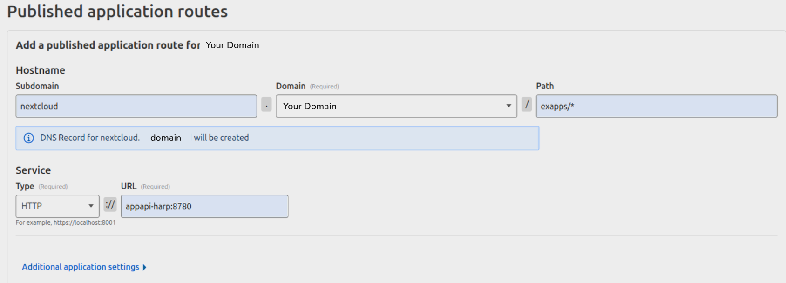
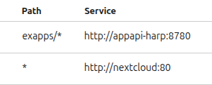

<!--
 - SPDX-FileCopyrightText: 2025 Nextcloud GmbH and Nextcloud contributors
 - SPDX-License-Identifier: AGPL-3.0-or-later
-->
# Nextcloud AppAPI HaProxy Reversed Proxy (HaRP)

HaRP is the reverse proxy and deploy daemon of Nextcloud's AppAPI since Nextcloud 32, and replaces the Docker Socket Proxy (DSP). Clients reach ExApps through HaRP directly instead of through Nextcloud. HaRP checks each request against the routes of the ExApp, protects against brute force, and deploys ExApps to one or more Docker Engines, local or remote over FRP, or to Kubernetes. It serves ExApps over HTTP and HTTPS and can run on the Nextcloud host or on a separate one.

The admin manual describes the [deployment configurations](https://docs.nextcloud.com/server/latest/admin_manual/exapps_management/DeployConfigurations.html#docker-deploy-daemon-harp) step by step, including Nextcloud, the reverse proxy and Docker on [three separate hosts](https://docs.nextcloud.com/server/latest/admin_manual/exapps_management/DeployConfigurations.html#docker-reverse-proxy-nextcloud-on-3-independent-hosts-with-harp-container).

## How to Install It

Run HaRP where your reverse proxy can reach its `HP_EXAPPS_ADDRESS`; for a home installation that can be the Nextcloud host.

```bash
docker run \
  -e HP_SHARED_KEY="some_very_secure_password" \
  -e NC_INSTANCE_URL="http://nextcloud.local" \
  -v /var/run/docker.sock:/var/run/docker.sock \
  -v `pwd`/certs:/certs \
  --name appapi-harp -h appapi-harp \
  --restart unless-stopped \
  -p 8780:8780 \
  -p 8782:8782 \
  -d ghcr.io/nextcloud/nextcloud-appapi-harp:release
```

> **Warning:** Change `HP_SHARED_KEY` to a secret value of your own.

Publish port 8780 (ExApps) where your reverse proxy can reach it, for example on the host's `127.0.0.1`, and port 8782 (FRP) where remote Docker Engines and ExApps can reach it. Set `HP_TRUSTED_PROXY_IPS` to the address or network (CIDR) at which HaRP sees your reverse proxy. When the proxy runs on another host, set `NC_INSTANCE_URL` to the public URL of Nextcloud.

### Using Host Networking

```bash
docker run \
  -e HP_SHARED_KEY="some_very_secure_password" \
  -e NC_INSTANCE_URL="http://nextcloud.local" \
  -e HP_EXAPPS_ADDRESS="192.168.2.5:8780" \
  -v /var/run/docker.sock:/var/run/docker.sock \
  -v `pwd`/certs:/certs \
  --name appapi-harp -h appapi-harp \
  --restart unless-stopped \
  --network host \
  -d ghcr.io/nextcloud/nextcloud-appapi-harp:release
```

> **Note:** With host networking, HaRP's internal ports are on the host's loopback interface, where every process on the host can use them. That includes ExApps with host networking (the default of the `HaRP Proxy (Host)` daemon template and of `occ app_api:daemon:register`). These are the agent (`127.0.0.1:8200`), its SPOE port (`127.0.0.1:9600`) and the FRP tunnels (`127.0.0.1:23000-24099`). The agent requires the shared key, but the SPOE port and the Docker Engine tunnels do not, and `127.0.0.1:24000` controls the Docker Engine like its socket. If your ExApps use host networking, prefer the bridge deployment above. To move an existing HaRP to it, set `HP_EXAPPS_ADDRESS` back to `0.0.0.0:8780`, publish ports 8780 and 8782, set `NC_INSTANCE_URL` to an address the container can reach (not `localhost`), and replace `127.0.0.1` in `HP_TRUSTED_PROXY_IPS` with the Docker bridge gateway.

## Configuring Your Reverse Proxy

Forward `/exapps/` of your Nextcloud domain to HaRP's `HP_EXAPPS_ADDRESS`. Replace `127.0.0.1` in the examples with HaRP's address if it runs on another host. The read timeout of 1800 seconds matches HaRP's `HP_TIMEOUT_SERVER` and is needed by slow ExApps such as `context_chat_backend`.

### NGINX

```nginx
server {
    listen 80;
    server_name nextcloud.com;

    location /exapps/ {
        proxy_pass http://127.0.0.1:8780/exapps/;
        proxy_http_version 1.1;
        proxy_set_header Upgrade $http_upgrade;
        proxy_set_header Connection "upgrade";
        proxy_set_header Host $host;
        proxy_set_header X-Real-IP $remote_addr;
        proxy_set_header X-Forwarded-For $proxy_add_x_forwarded_for;
        proxy_set_header X-Forwarded-Proto $scheme;
        proxy_read_timeout 1800s;
    }
}
```

`proxy_http_version` and the `Upgrade` and `Connection` headers let WebSocket connections through to ExApps.

nginx resolves a name in `proxy_pass` (such as the container `appapi-harp` on a user-defined Docker network) only at startup, and does not start while that name cannot be resolved. To resolve it per request, add these lines to the `server` block above and change its `proxy_pass` to `proxy_pass $harp_upstream;`:

```nginx
    resolver 127.0.0.11 valid=30s;               # Docker's embedded DNS; use your own resolver outside Docker
    set $harp_upstream http://appapi-harp:8780;  # no /exapps/ suffix: with a variable, nginx sends every request to exactly that path
```

`127.0.0.11` answers only inside containers on a user-defined network, and nginx's `resolver` ignores `/etc/hosts`, so keep the plain `proxy_pass` for names added with `--add-host` or `extra_hosts`.

### Caddy

```caddyfile
nextcloud.com {
    reverse_proxy /exapps/* 127.0.0.1:8780 {
        transport http {
            read_timeout 1800s
        }
    }
}
```

### Traefik

```yaml
http:
  routers:
    exapps:
      rule: "PathPrefix(`/exapps/`)"
      service: exapps-service
      entryPoints:
        - web
  services:
    exapps-service:
      loadBalancer:
        servers:
          - url: "http://127.0.0.1:8780"
        serversTransport: exapps-transport
  serversTransports:
    exapps-transport:
      forwardingTimeouts:
        responseHeaderTimeout: 1800s
```

### Apache

In the virtual host of your Nextcloud, before the existing configuration:

```apache
ProxyPass /exapps/ http://127.0.0.1:8780/exapps/
ProxyPassReverse /exapps/ http://127.0.0.1:8780/exapps/
ProxyTimeout 1800
```

### Cloudflare Tunnel





> **Note:** The order of the routes matters: move the `exapps/*` route above your Nextcloud's main route.

## Nextcloud Configuration

Register HaRP as a deploy daemon in the AppAPI admin settings with the `HaRP Proxy (Host)` or `HaRP Proxy (Docker)` template and the same shared key, then test it with "Test deploy" in the menu of the daemon. See [Troubleshooting](#troubleshooting) if the test fails.

## Environment Variables

- **`HP_EXAPPS_ADDRESS`** / **`HP_EXAPPS_HTTPS_ADDRESS`**: address and port of the HTTP and HTTPS frontends for ExApps, which Nextcloud and your reverse proxy must reach. Default `0.0.0.0:8780` and `0.0.0.0:8781`. `0.0.0.0` listens on IPv4 only; on an IPv6-only cluster use `[::]:8780` and `[::]:8781`. The HTTPS frontend is enabled only when `/certs/cert.pem` (certificate and private key in one PEM file) exists.

- **`HP_TRUSTED_PROXY_IPS`**: comma-separated IP addresses or CIDR ranges of the reverse proxies in front of HaRP, whose `X-Forwarded-For` and `X-Real-IP` headers HaRP uses to find the client's address. Default empty. Example: `"172.18.0.0/16,127.0.0.1"`. Quotes around the value or an entry are ignored, a range with host bits set (`192.168.100.20/24`) means its network, as in Nextcloud's `trusted_proxies`, and an entry that cannot be parsed is logged and ignored.

- **`HP_FRP_ADDRESS`**: address and port of the FRP frontend, which remote Docker Engines and ExApps must reach. Default `0.0.0.0:8782`.

- **`HP_SPOA_ADDRESS`**: address and port of the internal SPOE agent. Default `127.0.0.1:9600`; change it only if the port is taken.

- **`HP_SHARED_KEY`** (or **`HP_SHARED_KEY_FILE`**): the secret shared with AppAPI. Required; set only one of the two, with printable ASCII characters only, without `"` or `\`. ExApp containers that HaRP creates get a token derived from it, which HaRP accepts only for the FRP login; HaRP's own FRP client and remote Docker Engines keep using the key, and an `frps.toml` of your own needs no change.
  - **Upgrading:** ExApp containers created by HaRP 0.4.5 or older keep the key until their next update. If you roll HaRP back to 0.4.5 or older, the ExApps deployed by a newer release cannot connect, and their login attempts soon get their address banned, which with host networking is usually also Nextcloud's. Upgrade HaRP again, or stop those ExApp containers, restart HaRP and deploy them again by an update or by registering them again.

- **`NC_INSTANCE_URL`**: the base URL of Nextcloud, reachable from the HaRP container.

- **`HP_DOCKER_ENGINE_PORTS`**: comma-separated ports and ranges on HaRP's loopback interface that AppAPI may address with its `docker-engine-port` header; other ports are refused (`403` on the Docker API passthrough, `400` on the `/docker/exapp/*` endpoints). Default `24000-24099`, the FRP tunnels of Docker Engines (`24000` is the bundled engine). Add a port when AppAPI reaches a Docker Engine through another one, such as an FRP tunnel in `23000-23999` or a socket proxy over host networking. HaRP passes no credentials to these ports, so such a proxy must accept requests without them and should listen on `127.0.0.1` only. An empty value means the default; HaRP does not start with a malformed one.

- **`HP_FRP_DISABLE_TLS`**: disables TLS for FRP, for setups that terminate TLS elsewhere. Default `false`.

- **`HP_EXAPP_BIND_MOUNTS_DISABLED`** / **`HP_EXAPP_BIND_MOUNTS_ALLOWED`** / **`HP_EXAPP_BIND_MOUNTS_DENIED`** / **`HP_EXAPP_BIND_MOUNTS_ENFORCE_ALL`**: rules for the host paths an administrator may bind mount into ExApp containers on a Docker Engine. A container whose mounts break a rule is not created; AppAPI shows the rule and the mount, and HaRP logs them. The Kubernetes backend does not support bind mounts.
  - `HP_EXAPP_BIND_MOUNTS_DISABLED`: `true` refuses every bind mount. Default `false`.
  - `HP_EXAPP_BIND_MOUNTS_ALLOWED`: comma-separated host paths; when set, only these paths and the paths below them may be mounted. Default empty (any path that is not denied). Example: `"/mnt/models,/srv/exapps"`.
  - `HP_EXAPP_BIND_MOUNTS_DENIED`: comma-separated host paths that may not be mounted, nor a path below or above them; `:rw` after an entry refuses only read-write mounts. Setting it replaces the default list, and an empty value removes it. Default: `"/proc,/sys,/boot,/var/lib/docker,/var/lib/containerd,/var/lib/containers,/run/docker.sock,/var/run/docker.sock,/run/containerd,/var/run/containerd,/run/podman,/var/run/podman,/run/crio,/var/run/crio,/etc/shadow,/etc/gshadow,/etc/sudoers,/etc/sudoers.d,/etc/ssh,/dev,/run,/var/run,/root,/var/lib/docker/volumes,/var/lib/containers/storage/volumes,/etc:rw,/usr:rw,/bin:rw,/sbin:rw,/lib:rw,/lib64:rw,/var/spool:rw"`.
  - `HP_EXAPP_BIND_MOUNTS_ENFORCE_ALL`: this release only warns about mounts refused just by `/dev`, `/run`, `/var/run`, `/root`, the two volume directories or a `:rw` entry of the default list, and about modes other than `ro` or `rw` (such as `z`, which mounts read-write). `true` refuses them now; a later release will refuse them by default. A mount that contains another entry, such as `/run` itself, is always refused, and so is everything a list you set denies. Default `false`.
  - When an allowed and a denied entry both cover a mount, the longer one decides, and denied wins a tie: `HP_EXAPP_BIND_MOUNTS_ALLOWED="/mnt/models,/var/run/mysqld"` permits `/var/run/mysqld/mysqld.sock` while `/var/run/docker.sock` stays refused. An allowed list restricts every other mount too, so list all the sources you mount; `HP_EXAPP_BIND_MOUNTS_DENIED="/"` with an allowed list permits nothing else.
  - A mount without a mode is read-write, so add `:ro` to mounts of system paths such as `/etc/localtime`. On Docker Desktop for Windows, host paths are below `/run`, so set `HP_EXAPP_BIND_MOUNTS_ALLOWED="/run/desktop/mnt/host"` there; the sockets of rootless Docker and Podman (`/run/user/<uid>/...`) are permitted with a warning.
  - Paths are normalized and compared as text; HaRP cannot see symbolic links on the Docker host, so set an allowed list for a strict rule. Entries and mounts must be absolute paths without a `..` segment, `:` or control characters, and HaRP does not start with a malformed entry.
  - **Upgrading:** AppAPI sends the stored mounts of an ExApp again on every update, after it has removed the old container, so a refused mount leaves the ExApp without a container, and `occ app_api:app:update` does not retry because the new version is already stored. Rolling HaRP back does not repair it. Unregister the ExApp with `occ app_api:app:unregister <appid> --force` (its data is kept unless you add `--rm-data`) and register it again with its environment variables and corrected mounts, because unregistering deletes its deploy options. Before upgrading from 0.4.5 or older, check the mounts of your ExApps (shown in their deploy options) against these rules; the [0.4.6 release notes](https://github.com/nextcloud/HaRP/releases/tag/v0.4.6) list what changed.

- **`HP_LOG_LEVEL`**: `debug`, `info`, `warning` or `error`. Default `warning`. Case, blanks and quotes do not matter, `warn` means `warning`, and any other value falls back to `warning`.

- **`HP_WATCHDOG_ENABLED`** / **`HP_WATCHDOG_INTERVAL`** / **`HP_WATCHDOG_FAILS`**: every `HP_WATCHDOG_INTERVAL` seconds the container probes the agent, and after `HP_WATCHDOG_FAILS` consecutive failures it exits so that the restart policy starts it again; it also exits when a core process (agent, frps, frpc, HAProxy) dies. Default `true`, `10` and `12`, which detects a dead agent in about 2 minutes. To reload the HAProxy configuration and certificates without a restart, run `docker exec appapi-harp kill -HUP 1`, not `docker kill -s HUP`, after which Docker no longer restarts the container on its own.

- **`HP_VERBOSE_START`**: verbose output while the container starts. Default `1`.

- **`HP_SESSION_LIFETIME`**: seconds (`0` to `10`, fractions allowed) for which HaRP keeps a Nextcloud session; `0` disables the cache. Default `3`.

- **`HP_BLACKLIST_COUNT`** / **`HP_BLACKLIST_WINDOW`**: HaRP drops every request from an address with this many failures within this many seconds. Failures are requests HaRP refuses (such as a wrong key, no route or no access) and responses with a status the route lists in `bruteforce_protection`. Default `10` and `300`.

- **Timeouts:**
  - `HP_TIMEOUT_CONNECT`: for establishing a connection. Default `30s`.
  - `HP_TIMEOUT_CLIENT`: inactivity while HaRP waits for the client's request, not of a streaming response. Default `30s`; raising it weakens the protection against slow clients.
  - `HP_TIMEOUT_SERVER`: inactivity of the connection to the ExApp, also of an established streaming response (SSE). Default `1800s`; changing it is not recommended.
  - `HP_TIMEOUT_TUNNEL`: inactivity of upgraded connections (WebSockets). Default: the value of `HP_TIMEOUT_SERVER`. `0` means unlimited (HAProxy's maximum of `24d`) while the connection is open in both directions; half-closed connections are closed after 30 seconds.

## Connecting Docker Engines

### Local Docker Engine

Mount the Docker socket into the HaRP container: `-v /var/run/docker.sock:/var/run/docker.sock`.

### Remote Docker Engines via FRP

For a Docker Engine on another host, or to avoid mounting the socket, connect the engine to HaRP with an FRP client:

1. Copy the FRP client certificates that HaRP generates in `/certs/frp` to the Docker Engine host:

   ```bash
   mkdir -p harp_frpc_docker/certs/frp
   cd harp_frpc_docker
   for f in {client.crt,client.key,ca.crt}; do docker cp appapi-harp:/certs/frp/$f certs/frp/; done
   ```

2. Create `frpc.toml` in the same folder:

   ```toml
   serverAddr = "your.harp.server.address"          # the host of HP_FRP_ADDRESS
   serverPort = 8782                                # the port of HP_FRP_ADDRESS, or of your reverse proxy
   loginFailExit = false                            # keep trying while HaRP is unavailable

   transport.tls.certFile = "certs/frp/client.crt"
   transport.tls.keyFile = "certs/frp/client.key"
   transport.tls.trustedCaFile = "certs/frp/ca.crt"
   transport.tls.serverName = "harp.nc"             # DO NOT CHANGE THIS VALUE

   metadatas.token = "HP_SHARED_KEY"                # HP_SHARED_KEY in quotes

   [[proxies]]
   remotePort = 24001                               # unique per Docker Engine, 24001-24099
   name = "deploy-daemon-1"                         # unique per Docker Engine
   type = "tcp"
   [proxies.plugin]
   type = "unix_domain_socket"
   unixPath = "/var/run/docker.sock"
   ```

3. Run the FRP client, with `frpc -c /path/to/frpc.toml` or as a container:

   ```yaml
   services:
     harp_frpc_docker:
       image: ghcr.io/fatedier/frpc:v0.71.1
       container_name: harp_frpc_docker
       volumes:
         - ./frpc.toml:/etc/frpc.toml
         - ./certs:/certs
         - /var/run/docker.sock:/var/run/docker.sock
       restart: unless-stopped
       command: -c=/etc/frpc.toml
   ```

The FRP connection can pass through your reverse proxy as well, for example with an nginx `stream` block. On HaRP's own host, which publishes 8782 already, listen on another port and use it as `serverPort` in `frpc.toml`:

```nginx
stream {
    server {
        listen 8782;  # the port frpc connects to
        proxy_pass 127.0.0.1:8782;
        proxy_protocol off;
        proxy_connect_timeout 10s;
        proxy_timeout 300s;
    }
}
```

> **Note:** The FRP certificates are valid for `HP_FRP_CERT_VALIDITY_DAYS` days (default `5000`, about 13 years) and are not renewed automatically. To renew them, stop HaRP, delete its `/certs/frp` folder and start it again, copy the new files to every remote Docker Engine and restart its `frpc`, then remove and install each ExApp again, because ExApps embed the certificates at install time.

## Kubernetes Backend

With `HP_K8S_ENABLED=true` HaRP deploys ExApps to a Kubernetes cluster through its API instead of a Docker Engine. In a single namespace it creates one `Deployment` per ExApp (one per role for multi-role ExApps), one shared `PersistentVolumeClaim` per ExApp, and a `Service` for the `nodeport`, `clusterip` and `loadbalancer` exposure types (`manual` exposure stores the upstream address as annotations on the `Deployment`).

- **`HP_K8S_ENABLED`**: enables the Kubernetes backend. Default `false`.
- **`HP_K8S_NAMESPACE`**: the namespace of the ExApp resources, which HaRP never creates itself. Default `nextcloud-exapps`.
- **`HP_K8S_STORAGE_CLASS`**: storage class of the ExApp volume claims. Default empty (the cluster default).
- **`HP_K8S_DEFAULT_STORAGE_SIZE`**: size of each ExApp's volume claim. Default `10Gi`.
- **`HP_K8S_HOST_ALIASES`**: extra host aliases for the ExApp pods, as comma-separated `hostname:ip` pairs, e.g. `nextcloud.example.com:10.0.0.5` or `nextcloud.example.com:[fd00::5]`, for a Nextcloud domain the cluster DNS cannot resolve. Default empty.
- **`HP_K8S_API_SERVER`**: URL of the API server. Use `https://`: HaRP sends its bearer token with every request and does not refuse other schemes. Default: `https://$KUBERNETES_SERVICE_HOST:$KUBERNETES_SERVICE_PORT` in a pod, otherwise empty.
- **`HP_K8S_BEARER_TOKEN`** / **`HP_K8S_BEARER_TOKEN_FILE`**: the service account token, as a value (read once at startup) or a file (read on every request, so a rotated token is picked up). Set only one. Default: the token mounted into the pod.
- **`HP_K8S_CA_FILE`**: CA certificate of the API server; without the file HaRP uses the system trust store. Default: the CA mounted into the pod.
- **`HP_K8S_VERIFY_SSL`**: `false` skips verification of the API server certificate, for test clusters only. Default `true`.

In a pod, `HP_K8S_ENABLED` is all HaRP needs: it uses the pod's service account. Outside the cluster, set `HP_K8S_API_SERVER` and give HaRP the token of a service account with the permissions below, with a lifetime that outlives HaRP: `kubectl create token` issues one-hour tokens unless you pass `--duration` (the development scripts use `8760h`), and a `kubernetes.io/service-account-token` Secret gives a token that does not expire. The `/info` endpoint reports whether the API server answers; it proves connectivity and authentication only, so a missing permission shows up as `403` on the first install.

### RBAC Permissions

HaRP uses the Kubernetes API only to manage ExApp workloads inside `HP_K8S_NAMESPACE`. This is the complete set of permissions it needs; a namespaced `Role` is enough for every exposure type except `NodePort`:

```yaml
apiVersion: rbac.authorization.k8s.io/v1
kind: Role
metadata:
  name: harp-exapps
  namespace: nextcloud-exapps   # the ExApp namespace, must match HP_K8S_NAMESPACE
rules:
  - apiGroups: ["apps"]
    resources: ["deployments"]
    verbs: ["get", "list", "create", "patch", "delete"]
  - apiGroups: [""]
    resources: ["services"]
    verbs: ["get", "list", "create", "delete"]
  - apiGroups: [""]
    resources: ["persistentvolumeclaims"]
    verbs: ["create", "delete"]
  - apiGroups: [""]
    resources: ["pods"]
    verbs: ["list"]
---
apiVersion: rbac.authorization.k8s.io/v1
kind: RoleBinding
metadata:
  name: harp-exapps
  namespace: nextcloud-exapps   # the ExApp namespace, where the Role lives
roleRef:
  apiGroup: rbac.authorization.k8s.io
  kind: Role
  name: harp-exapps
subjects:
  - kind: ServiceAccount
    name: harp                  # the service account of the HaRP pod, or the one whose token HaRP uses
    namespace: nextcloud        # the namespace the HaRP pod runs in, not the ExApp namespace
```

The subject must match the service account HaRP authenticates with exactly, or every request answers `403`. The manifest creates neither the namespace nor the service account: create them first (`kubectl create namespace nextcloud-exapps`, `kubectl -n nextcloud create serviceaccount harp`) and run the HaRP pod with `serviceAccountName: harp`.

| Resource | Verbs | Used for |
| --- | --- | --- |
| `apps/deployments` | `create`, `delete` | Installing and removing an ExApp. |
| `apps/deployments` | `get`, `list` | Checking whether an ExApp exists, and reading the upstream address of a `manual` ExApp from the annotations. |
| `apps/deployments` | `patch` | Scaling an ExApp to 1 replica when it is enabled and to 0 when it is disabled, and recording the exposure details (strategic merge patches only). |
| `services` | `create`, `get`, `list`, `delete` | Exposing an ExApp, reading its port or address back (also after a HaRP restart), waiting for a `LoadBalancer` address, and cleaning up. `manual` exposure creates no `Service` but still looks for one. |
| `persistentvolumeclaims` | `create`, `delete` | The volume of an ExApp, sized by `HP_K8S_DEFAULT_STORAGE_SIZE` and placed by `HP_K8S_STORAGE_CLASS`. |
| `pods` | `list` | Polling readiness while an ExApp starts, so that image pull failures are reported at once. |

HaRP never requests `secrets`, `configmaps`, `events`, `namespaces`, `pods/log`, `pods/exec`, `watch` or `update`, and sets no `ownerReferences`. The permissions cannot be limited to deployment time: enabling, disabling and removing an ExApp also write.

### NodePort Also Needs `nodes`

With `NodePort` exposure (`--k8s_expose_type nodeport`) HaRP lists the cluster-scoped `nodes` to pick a node address when it enables an ExApp and after every restart, and when it exposes one without `--k8s_upstream_host`. A namespaced `Role` cannot grant that:

```yaml
apiVersion: rbac.authorization.k8s.io/v1
kind: ClusterRole
metadata:
  name: harp-nodes
rules:
  - apiGroups: [""]
    resources: ["nodes"]
    verbs: ["list"]
---
apiVersion: rbac.authorization.k8s.io/v1
kind: ClusterRoleBinding
metadata:
  name: harp-nodes
roleRef:
  apiGroup: rbac.authorization.k8s.io
  kind: ClusterRole
  name: harp-nodes
subjects:
  - kind: ServiceAccount
    name: harp                  # the same service account as in the RoleBinding above
    namespace: nextcloud
```

`clusterip` (the default), `loadbalancer` and `manual` exposure need no cluster-scoped permission.

### Hardening the ExApp Pods

ExApp pods run under the `default` service account of `HP_K8S_NAMESPACE`. Leave it without any `RoleBinding` and consider `automountServiceAccountToken: false` on it, so that ExApp containers get no Kubernetes API credentials. For images from a registry that needs authentication, add the pull secret to that service account (`kubectl -n <namespace> patch serviceaccount default -p '{"imagePullSecrets":[{"name":"<secret>"}]}'`). ExApp containers use `imagePullPolicy: IfNotPresent`, or `Never` when AppAPI maps the image registry to `local`, in which case the image must be present on every node that can run the pod.

## Adapting ExApps to use HaRP

The developer manual describes how to [adapt an ExApp to HaRP](https://docs.nextcloud.com/server/latest/developer_manual/exapp_development/development_overview/ExAppHarpIntegration.html): the `start.sh` entrypoint from `exapps_dev` and the FRP client in the image, version 0.71.1 like HaRP's FRP server, checked against the checksums of its release. DSP is deprecated and will be removed in Nextcloud 35; an ExApp with HaRP support still works with DSP, so one release serves both. For the routes in your `info.xml`:

1. List in the `<verb>` of each route every HTTP method it serves, e.g. `GET,POST`. The first route whose URL and verb match a request decides its access level, `HEAD` is allowed wherever `GET` is, and a method that no route of the path lists gets `405 Method Not Allowed`. HaRP 0.4.7 and older, and HaRP with an AppAPI that does not send the verbs (AppAPI sends them from Nextcloud 33.0.11, 34.0.6 and 35.0.3), match by URL only, so use different URLs where methods need different access levels.

2. Write the URLs of your routes for the decoded path, as your ExApp reads it, and start them with `/` or `^/`. Write a route for a directory as `^/img(/.*)?$`, so that `/img` and `/img/` keep its level. Where servers read a path differently (letter case, a trailing slash, `//`, `;` parameters, an escaped `/`, `?` or `#`), the highest access level among those readings applies. HaRP forwards a user's request with `//` merged and escaped letters, digits and `-._~` decoded. Paths with `.` or `..` segments are refused. Paths with control characters, and the `/heartbeat`, `/init` and `/enabled` endpoints, are refused unless AppAPI sends the request. HaRP 0.4.7 and older check routes on the path as sent.

## Nextcloud 32: Migrating Existing ExApps from DSP to HaRP

If you've upgraded to Nextcloud 32 and want to switch from using DSP to HaRP, follow these steps:

1. **Install HaRP** on the same Docker Engine that you were using for DSP.
2. **Test Deployment on HaRP** with "Test deploy" in the menu of the daemon.
3. **Set HaRP as the default deployment daemon** for ExApps.
4. **Remove the ExApps without deleting their data volumes**:
   - **Terminal**: Do not use the `--rm-data` option when removing the app.
   - **From UI**: Do not use the "Delete data when removing" checkbox.
5. **Install the ExApp**: Install removed ExApps, now they will be installed on `HaRP`.
6. **Remove DSP**: Now DSP (Docker Socket Proxy) can be safely removed.

## Building & Deploying HaRP from Source

With [nextcloud-docker-dev](https://github.com/nextcloud/nextcloud-docker-dev):

```bash
docker container remove --force appapi-harp
docker build -t nextcloud-appapi-harp:local .
docker run \
  -e HP_SHARED_KEY="some_very_secure_password" \
  -e NC_INSTANCE_URL="http://nextcloud.local" \
  -e HP_LOG_LEVEL="debug" \
  -e HP_VERBOSE_START="1" \
  -e HP_TRUSTED_PROXY_IPS="192.168.0.0/16" \
  -v /var/run/docker.sock:/var/run/docker.sock \
  -v `pwd`/certs:/certs \
  --name appapi-harp -h appapi-harp \
  --restart unless-stopped \
  --network=master_default \
  -p 8780:8780 \
  -p 8782:8782 \
  -d nextcloud-appapi-harp:local
```

### Debugging HaRP

To run the agent on the host, with only HAProxy in the container:

1. Create a virtual environment and install `requirements.txt` and `git+https://github.com/cloud-py-api/haproxy-python-spoa.git` at the commit pinned in the `Dockerfile`.
2. Run `haproxy_agent.py` with `HP_LOG_LEVEL=info`, `NC_INSTANCE_URL=http://nextcloud.local`, `HP_SHARED_KEY=some_very_secure_password` and `HP_FRP_DISABLE_TLS=true`.
3. Extract an FRP archive (from `exapps_dev` or the [FRP releases](https://github.com/fatedier/frp/releases)) into a `dev` folder at the root of the repository, and run `./dev/frps -c ./development/debugging/frps.toml` and `./dev/frpc -c ./development/debugging/frpc.toml`.
4. Point `/exapps/` of nextcloud-docker-dev at the host: put `location /exapps/ { proxy_pass http://172.17.0.1:8780/exapps/; }` into `data/nginx/vhost.d/nextcloud.local_location` and run `docker compose up -d --force-recreate proxy`.
5. Run `./development/debugging/redeploy_haproxy_host.sh`, which replaces the `appapi-harp` container with one that runs HAProxy only.
6. Register HaRP with the `HaRP Proxy (Host)` template, with `host.docker.internal` instead of `localhost` as the HaRP host.

## Troubleshooting

### Verify that HaRP can reach the Docker Engine

```bash
curl -fsS \
  -H "harp-shared-key: <HP_SHARED_KEY>" \
  -H "docker-engine-port: 24000" \
  http://127.0.0.1:8780/exapps/app_api/_ping
```

`24000` is the bundled Docker Engine (with `/var/run/docker.sock` mounted); for a remote engine use its `remotePort`. Use `https://...:8781` for the HTTPS frontend, with port 8781 published. The answers:

* `OK`: HaRP reaches the Docker Engine.
* `401 Unauthorized`: the `harp-shared-key` header does not match `HP_SHARED_KEY`.
* `403 Forbidden`: the port is not in `HP_DOCKER_ENGINE_PORTS`.
* `503 Service Unavailable` or `504 Gateway Timeout`: the FRP tunnel is down or the Docker Engine does not answer.
* A connection error: `HP_EXAPPS_ADDRESS` is not reachable from where you ran `curl`.

Inside the HaRP container (`docker exec -it appapi-harp sh`), `curl -fsS --unix-socket /var/run/docker.sock http://localhost/_ping` checks the mounted socket, and `curl -fsS http://127.0.0.1:24000/_ping` (or the `remotePort` of a remote engine) checks the FRP tunnel. Port 8200 is the agent's control API, not the Docker API.

### Verify the reverse proxy

Through the public URL, the same request without the key should get `401`, which shows that the reverse proxy forwards `/exapps/` to HaRP:

```bash
curl -sS -o /dev/null -w '%{http_code}\n' https://cloud.example.com/exapps/app_api/_ping
```

Run it only once. Every `401` counts as a failed attempt of the address HaRP sees: yours if `HP_TRUSTED_PROXY_IPS` lists the proxy, otherwise the proxy's, often Nextcloud's on a single host. After 10 within 5 minutes HaRP drops every request from that address.

To see the headers your reverse proxy sends, stop HaRP (`docker stop appapi-harp`), listen on its port with `nc -l -k -p 8780`, and send `curl -v https://cloud.example.com/exapps/hello`. With nginx, `nc` shows something like:

```
GET /exapps/hello HTTP/1.1
Host: cloud.example.com
Connection: close
X-Real-IP: 20.207.73.82
X-Forwarded-For: 20.207.73.82 192.168.21.1
X-Forwarded-Host: cloud.example.com
X-Forwarded-Proto: https
X-Forwarded-Port: 443
user-agent: curl/8.11.1
accept: */*
```

## Contributing

Contributions to HaRP are welcome: open issues, discussions or pull requests with improvements, bug fixes or new features.
